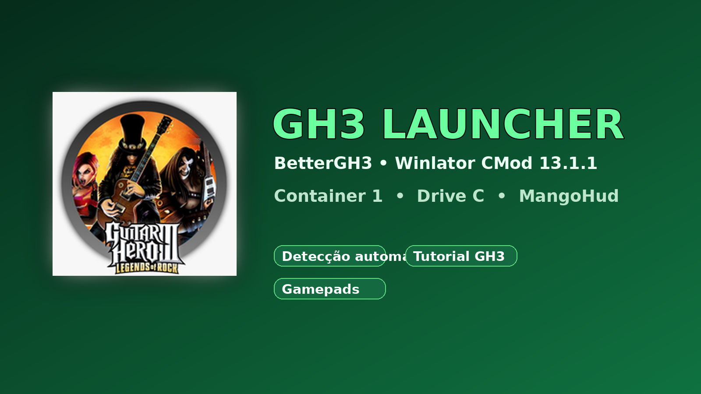

# GH3 Launcher

Launcher personalizado baseado no **Winlator CMod 13.1.1**, preparado para executar o Guitar Hero III com BetterGH3 no Android.

> O launcher não distribui o jogo, ROMs, executáveis originais ou assets protegidos. Use uma cópia do Guitar Hero III que você tenha direito de usar.

## Download

A APK fica publicada como asset da Release, porque tem aproximadamente 700 MB e o GitHub limita arquivos comuns do repositório a 100 MB.

- **[Baixar a APK mais recente](https://github.com/arthurguedesribeiro02-dev/GH3-LAUNCHER/releases/latest/download/GH3-CMod-BetterGH3-container1-manual-shortcut-r9-google-drive.apk)**
- **[Ver Releases e hashes](https://github.com/arthurguedesribeiro02-dev/GH3-LAUNCHER/releases)**

## Recursos

- Tema verde e identidade visual Guitar Hero III.
- Detecção do BetterGH3 em `Android/Download`.
- Instalação no **Container 1** existente.
- Cópia do jogo inteiro para `C:\Games\Guitar Hero III\Launcher\`.
- Tutorial GH3 com sete páginas.
- Links MediaFire, Mega e **Instalar via Google Drive GH3**.
- Gerenciador de arquivos interno do Winlator.
- MangoHud e suporte a controles Android/HID, incluindo gamepads originais e compatíveis.
- Orientação paisagem e foco em Android 8–16.

## Instalação rápida

1. Instale a APK pelo link da Release.
2. Abra o launcher e permita o acesso aos arquivos quando solicitado.
3. Crie o **Container 1** e aguarde os componentes/runtime terminarem.
4. Coloque o BetterGH3 em `Armazenamento interno/Download`.
5. Saia do container e abra o GH3 Launcher; a detecção copia o conteúdo para o Drive C do Container 1.
6. Em **Shortcuts**, crie um atalho manual para:

   `C:\Games\Guitar Hero III\Launcher\GH3.exe`

Não crie um segundo container para o GH3. Mantenha o ZIP ou a pasta original até confirmar que o jogo abre corretamente.

## Versões e forks

| Versão | Base | Uso | Link |
|---|---|---|---|
| GH3 Launcher r9 | Winlator CMod 13.1.1 | BetterGH3, Container 1, tutorial e instalação no Drive C | [Release](https://github.com/arthurguedesribeiro02-dev/GH3-LAUNCHER/releases/latest) |
| Winlator CMod 13.1.1 | Fork comunitário de Winlator | Base de compatibilidade Android/Wine/Box64 | [Winlator CMod](https://github.com/brunodev85/winlator) |
| Winlator original | Projeto upstream | Referência do runtime e da arquitetura | [Winlator original](https://github.com/brunodev85/winlator) |
| Winlator File Manager | Componente relacionado | Gerenciamento de arquivos dentro do ambiente Winlator | [WFM](https://github.com/brunodev85/wfm) |

As versões e forks são referenciados por links oficiais; o código de terceiros não é copiado para este repositório sem licença e autorização compatíveis.

## Guitar Hero III Deluxe e Xbox 360

O projeto comunitário **Guitar Hero III Deluxe** oferece pacotes separados para PC, Xbox 360, PS3, RPCS3, Wii e PS2. Este launcher apenas documenta e direciona para o projeto original; não redistribui os pacotes nem arquivos do jogo.

- [Guitar Hero III Deluxe](https://github.com/nsneverhax/guitar-hero-3-deluxe)
- [Pacote PC — instruções oficiais](https://github.com/nsneverhax/guitar-hero-3-deluxe#-installing-on-pc)
- [Pacote Xbox 360 — instruções oficiais](https://github.com/nsneverhax/guitar-hero-3-deluxe#-installing-on-xbox-360)
- [BetterGH3 — pacote usado pelo launcher](https://www.mediafire.com/file/lzje12anzxm6bjq/BetterGH3-FULLPACKAGE_v1.0.2.zip/file)
- [BetterGH3 — pasta Mega](https://mega.nz/folder/xdES1YpL#tj9dxP5H9P35jtASlKIVHw)
- [GH3 via Google Drive](https://drive.google.com/drive/folders/1gJgm-6jJ70KZ3hVzLDK8e8AQy_Y8D9RU)

## Mídia

- [Banner](assets/gh3-launcher-banner.png)
- [Ícone GH3 Launcher](assets/gh3-launcher-icon.png)
- [Vídeo curto de apresentação](assets/gh3-launcher-preview.mp4)

## Avisos

- Este é um projeto comunitário e não é afiliado à Activision, Neversoft, Microsoft ou aos autores do Winlator.
- A compatibilidade depende do aparelho, driver Vulkan, versão do Android, componentes do container e arquivos legítimos do usuário.
- Não abra issues solicitando jogos, ROMs, ISOs, XEX, executáveis originais ou arquivos protegidos por copyright.

## Licenciamento

As modificações e a documentação deste launcher são distribuídas separadamente dos componentes upstream. Consulte as licenças e os avisos de cada projeto vinculado antes de redistribuir qualquer parte deles.
